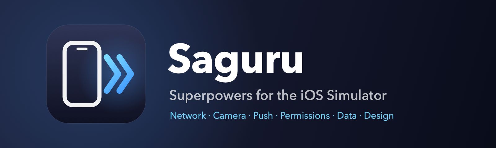
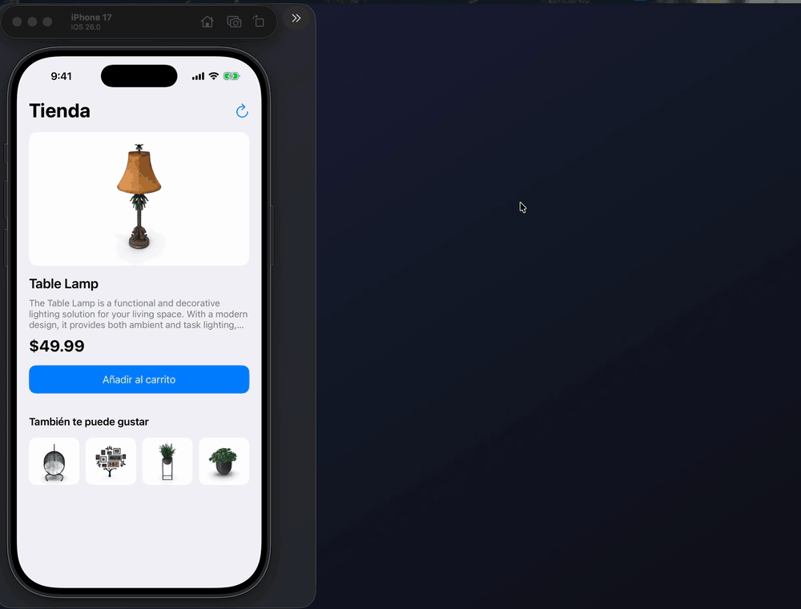
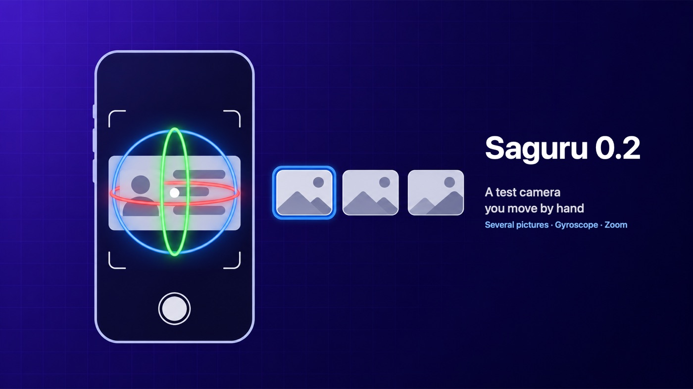
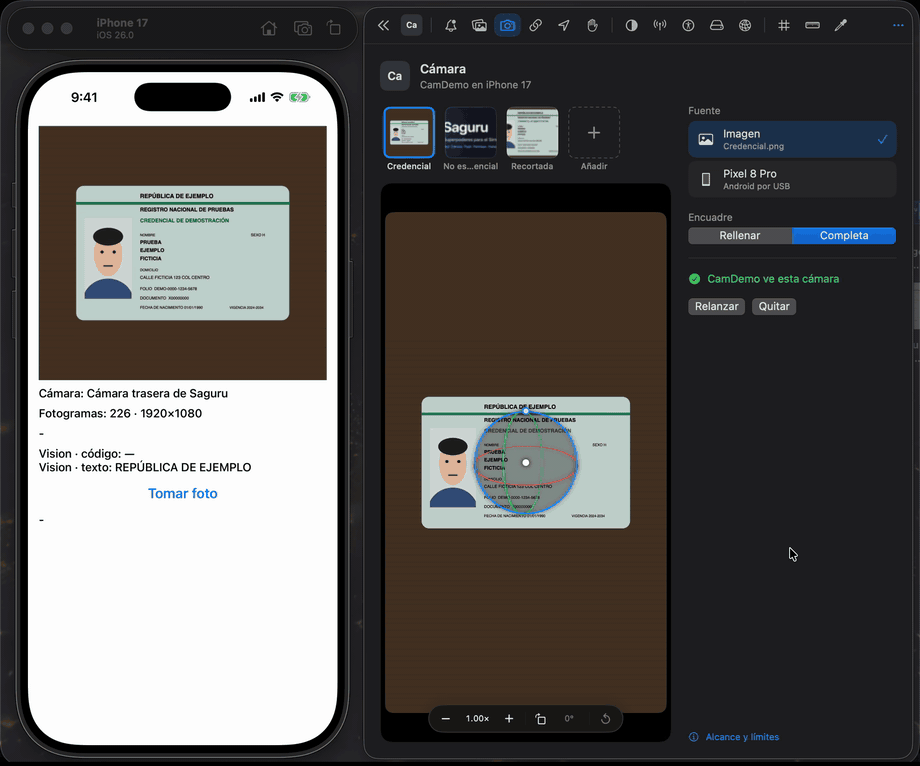
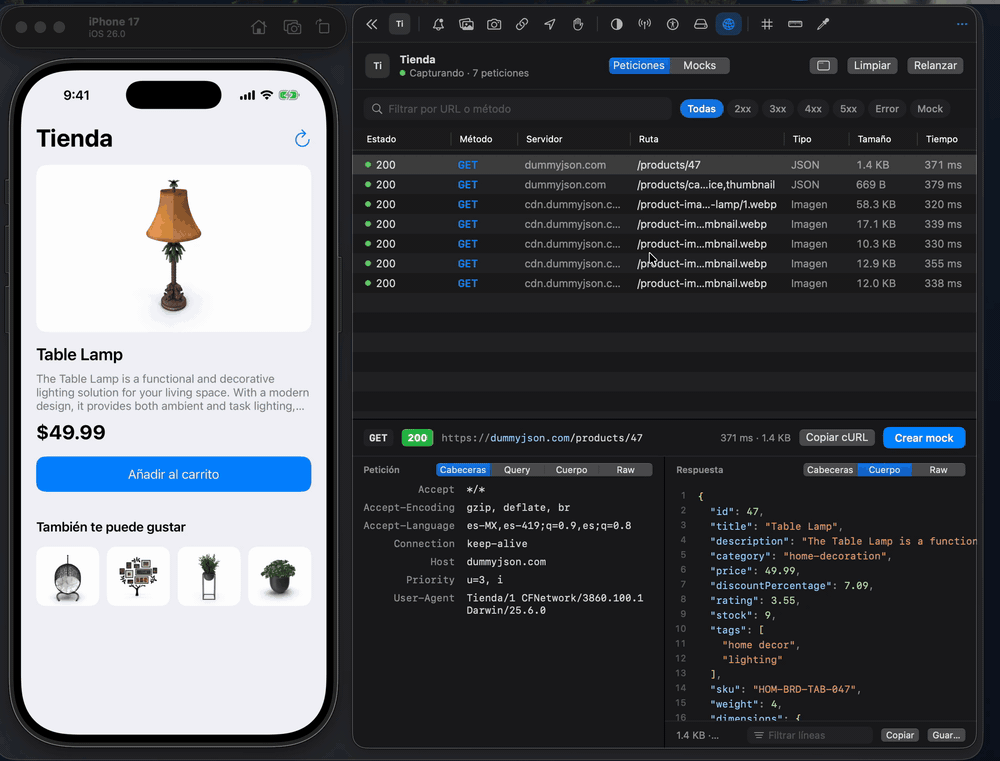
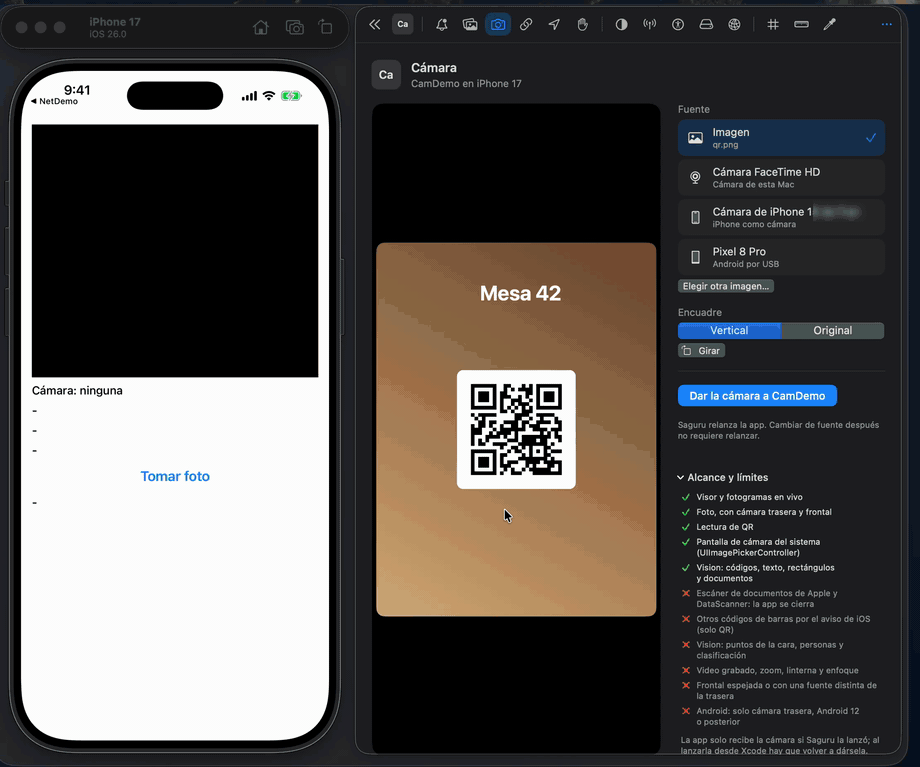
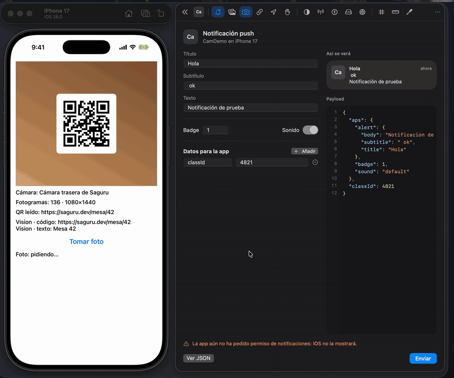
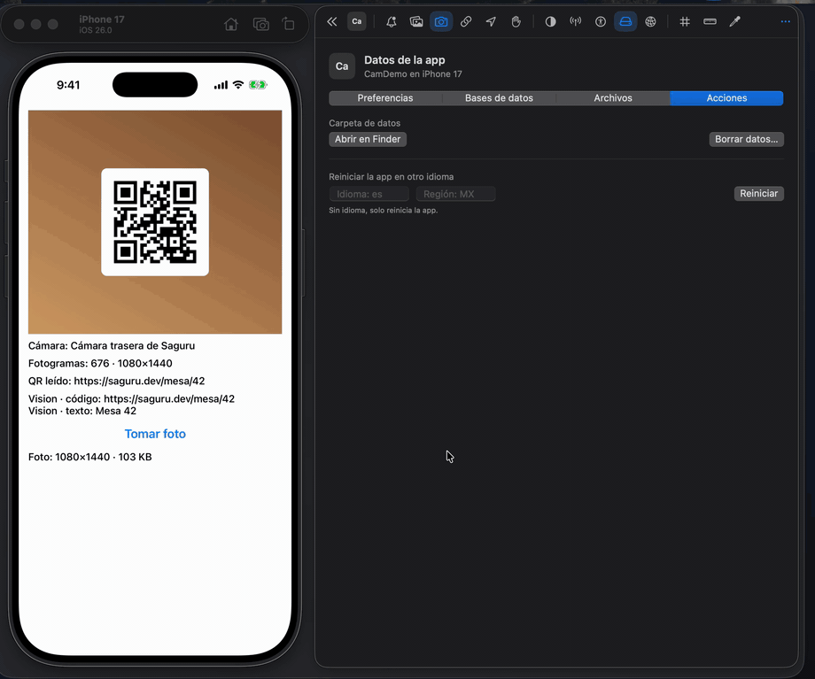
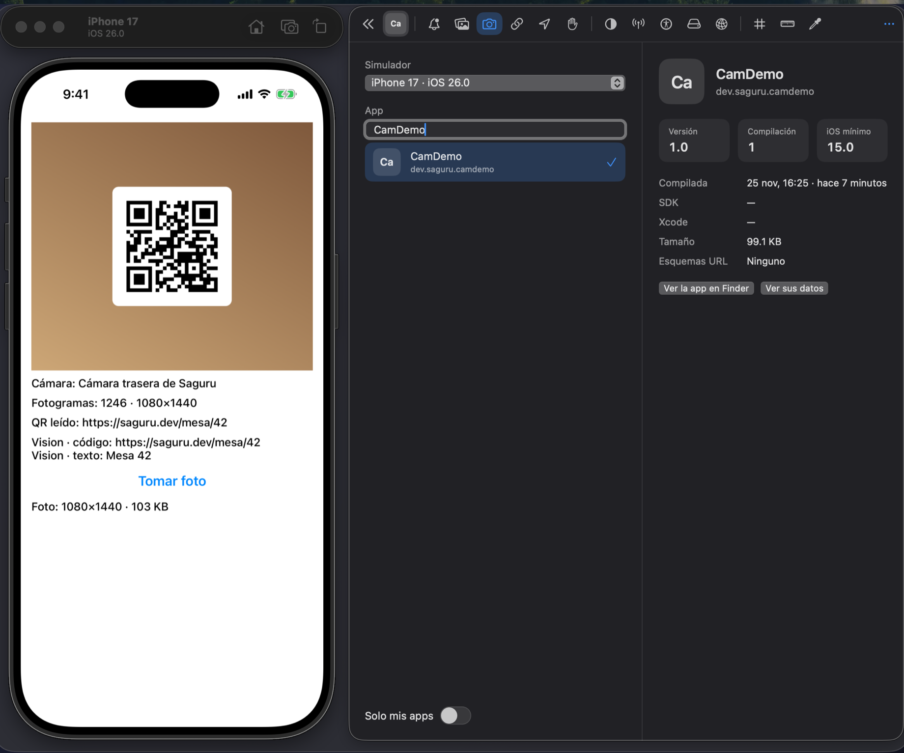

<p align="center">
  
</p>

<p align="center">
  <a href="README.md">Español</a> · <a href="README.en.md">English</a> · <a href="README.zh-CN.md">简体中文</a> · <a href="README.ja.md">日本語</a>
</p>

<p align="center">
  <b>Watch your app's network, give it a camera, send it notifications and measure it to the pixel.</b><br>
  All from a panel docked to the iOS Simulator. No proxy, no certificates, and no changes to your project.
</p>

<p align="center">
  macOS 14+ · Xcode · MIT License · Free and open source
</p>

---

**Saguru** (探る, "to probe") is a panel that docks to the iOS Simulator window, plus a CLI with the same actions. It brings together what usually takes several tools, a proxy with certificates, or a real device.

> The interface comes in Spanish, English, Simplified Chinese and Japanese; it follows your system language and can be changed from the `…` menu. The recordings below show it in Spanish.

<p align="center">
  
</p>

## New in 0.2: a test camera you move by hand

<p align="center">
  
</p>

Testing a capture flow used to mean printing the ID, holding the phone, tilting it, finding the light, and doing it again. With Saguru 0.2 you do it from your chair, in seconds:

- **One case per picture.** Load the good ID, the thing that is not an ID, and the one that came out cropped. Switch between them with a click (or ⌘1…⌘9) and your app gets it at once, with no relaunch.
- **A gyroscope on the picture.** The blue ring rotates it, dragging inside tilts it in perspective, and the hub moves it. It is what your hand would do with the phone, only repeatable.
- **Zoom in or out**, with buttons or a pinch.
- **A camera that behaves like a phone's.** Preset sizes, YUV frames, rotation and mirroring per connection, and every step of a photo capture. Tested against a real ID-capture flow.

<p align="center">
  
</p>

> **The first time**, Saguru greets you with a four-step introduction. And when a tool needs room (the network, the log, an app's data), the expand button takes Saguru full screen with the simulator set into one side; reduce it and the simulator goes back where it was.

## Why Saguru

- **It does not touch your app.** No SDK to integrate and no code to add. What has to live inside the app (network and camera) is loaded only when Saguru launches it, and only in the simulator.
- **No proxy, no certificates.** The network is observed from inside the app, so HTTPS is read as is, without installing a root certificate or reconfiguring the system.
- **A camera where there is none.** The simulator has no camera. Saguru gives your app one, with the picture you choose: a QR code, a document, your Mac's camera, your iPhone or an Android phone.
- **It lives where you work.** A `»` button beside the Simulator. Unfold it when you need it, fold it when you don't.
- **It is also a CLI.** The same actions work in scripts and in continuous integration.

## Install

```bash
git clone https://github.com/fsaldivar-dev/saguru.git
cd saguru
scripts/build.sh --install
saguru
```

Builds `build/Saguru.app` and links the `saguru` command into `/usr/local/bin` or `~/.local/bin`. Requires macOS 14 or later and Xcode. Once open, a `»` appears beside the Simulator; it has no Dock icon and quits with `saguru quit` or from the panel's `…` menu.

## What it does

### Network: see and replace what your app asks the server

Every request with its method, status, time and size. Request and response side by side, with headers, query and body: coloured JSON with line numbers, text, images and binaries. A raw HTTP view, a line filter and "Copy cURL".

**Create mock** turns a captured request into a saved response. You edit it as a single HTTP document, with autocompletion for status codes and headers, and it applies to the next request without relaunching.

<p align="center">
  
</p>

### Log: the console you lose outside Xcode

Launch the app from Saguru and you see what it prints (`print`, `NSLog`) and the errors the system logs for it, with a filter and copy. If the app closes, Saguru finds the report macOS writes and shows the kind of failure, the message (`Fatal error: …`, the uncaught exception) and the stack, with your own code highlighted. No Xcode and no Console app needed.

### Camera: what the simulator lacks

Pick an image, your Mac's camera, an iPhone, or an Android phone over USB, and your app sees it as its own camera: live preview, frames for Vision and OCR, QR reading, photo capture, front and back cameras, and the system camera screen. Changing the source does not require relaunching the app.

Prepare one case per picture (an ID, something that is not one, a cropped one) and switch between them with a click or ⌘1…⌘9 while the app keeps running. A gyroscope sits on the picture, like the one in a 3D editor: the blue ring rotates it, dragging inside tilts it in perspective, and the hub moves it; zoom is at the bottom. All of it applies to live cameras too.

<p align="center">
  
</p>

**iPhone over the cable, with no Wi-Fi and no iCloud.** Apple's Continuity Camera requires the same iCloud account on the iPhone and the Mac. Saguru offers two ways that do not:

- **Nothing to install: the iPhone's screen.** Plug in the cable, tap "Trust" and open the Camera app on the phone. "Pantalla de (your iPhone)" appears in the panel: Saguru receives the screen the way QuickTime does and crops it to the viewfinder, without the buttons. It is the closest iOS allows to what Android does: an iPhone will not run anything that is not an installed app.
- **The camera itself, with the Saguru Cámara app.** It gives the camera's picture without going through the screen, and lets you pick the back or front camera from the panel. Install it once with `scripts/install-companion.sh <TEAM_ID>`; it shows up as "iPhone por USB".

Plug in a camera, an iPhone or an Android phone while the tool is open and it shows up in the list by itself, marked as new; if the Android phone still has to accept USB debugging, Saguru says so right there.

<p align="center">
  
</p>

Along the way, Saguru makes Vision read barcodes in the simulator, where by default it returns nothing.

### Everything else, in the same panel

<p align="center">
  
</p>

| | Tool | What it does |
|---|---|---|
| Inject | **Push notification** | Title, subtitle, body, badge, sound and custom data, with a preview of the banner and the live payload. A JSON view to edit it or open an `.apns` file. Warns before sending if the app has no permission |
| | **Gallery** | The simulator's photos and videos: add (button or drag), select several, export to Finder, delete |
| | **Deep links** | Opens URLs and deep links. Shows the schemes and domains the app declares, and keeps favourites and history per app |
| | **Location** | A map where you pick the point with a click, a place search and editable coordinates |
| | **Permissions** | The permissions the app declares and their real state, in a grid: Ask, Limited, Allow or Never |
| Device | **Appearance** | Light or dark, and "Compare": both appearances at once with a handle to slide |
| | **Status bar** | Time, Wi‑Fi, cellular, data type and battery, with a preview. "Catalogue values" sets 9:41 and everything full |
| | **Accessibility** | A navigator in VoiceOver order, the element tree with identifiers, a scored audit, and settings (text size, contrast, motion, slow animations…) |
| | **App data** | Editable User Defaults, SQLite databases (Core Data, SwiftData) with queries, the container's files, erase data and relaunch in another language |
| Design | **Grid** | A grid and layout columns, with measurements by hierarchy as in a design tool |
| | **Rulers** | Cursor coordinates and guides to measure distances, without getting in the app's way |
| | **Colours** | The screen's palette, the named colours of the app's catalogue and an eyedropper. One click copies the SwiftUI `Color` |

<p align="center">
  
</p>

### A home page that tells you which app is in front of you

The panel opens on its home page: there you choose the app everything acts on (with search, remembered per simulator) and see its details: version, **build number**, minimum iOS, when it was built, SDK, size and URL schemes. If the Accessibility permission is missing, it asks for it right there and explains what it is for.

<p align="center">
  
</p>

## The CLI

The same actions, for the terminal and for scripts:

```bash
saguru devices
saguru apps
saguru push com.example.app -t "Order on its way" -b "Arrives in 10 minutes"
saguru push com.example.app --payload payload.json
saguru media photo.jpg video.mp4
saguru url myapp://profile/42
saguru location 19.4326 -99.1332        # or: saguru location clear
saguru privacy grant photos com.example.app
saguru appearance toggle
saguru statusbar clean                  # or: reset
saguru textsize accessibility-large     # or: increment / decrement
saguru contrast on
saguru data open com.example.app
saguru data erase com.example.app --yes
saguru defaults com.example.app
saguru defaults com.example.app onboardingSeen true --type bool
saguru relaunch com.example.app --lang en --region US
saguru query com.example.app "SELECT * FROM ZUSER LIMIT 10" --db default.store
```

With several simulators booted you must pick one with `-d "iPhone 17"` (name or UDID); Saguru does not guess.

## How it works

- Actions go through `xcrun simctl`; no private frameworks are used.
- Network and camera need the app to start with Saguru's agent inside (`agent/`, loaded with `DYLD_INSERT_LIBRARIES`; nothing is added to your project). They share a single launch, so turning one on never drops the other, and Saguru tells you when the app is closed or launched from somewhere else.
- The network agent sees `URLSession` requests, writes them to a temporary folder Saguru reads, and answers with the active mocks. Mocks are stored per app in `~/Library/Application Support/Saguru/mocks/`.
- The camera agent stands in for the missing camera inside the app and receives frames from Saguru through a memory-mapped file.
- The design tools and the inspector use the macOS Accessibility API to find the device screen inside the Simulator window.

## Known limits

Saguru would rather say what it does not do. The full list is in the [Spanish README](README.md#límites-conocidos); the main ones:

- **Network:** only what goes through `URLSession` (including Alamofire and the like). No gRPC, WebSockets, `WKWebView` or raw sockets. A mock matches a method and a URL, ignoring the query.
- **Camera:** covers `AVCaptureSession` and `UIImagePickerController`. Frames arrive as on a phone: in the session preset's size (4K is delivered as 1080p), lying on their side unless the app rotates the connection, in the pixel format it asks for, with the front camera mirrored in the preview. Apple's document scanner (VisionKit) and `DataScanner` are not covered, and an app that opens the document scanner with the camera active crashes. iOS's own code detection only delivers QR. No recorded video; zoom, torch and focus are accepted but do not change the picture. Any camera method without an answer of its own returns nothing instead of crashing, and is logged once as `Saguru camera: … has no stand-in`.
- **Android as a source:** needs `adb`, USB debugging and Android 12 or later; back camera only.
- **Vision in the simulator:** barcodes, text, rectangles and documents work. Face landmarks, people and image classification have no version that runs in the simulator.
- **Launch:** the app only gets the network monitor and the camera if Saguru launched it. Launch it from Xcode and you have to ask again.
- **Permissions:** the design tools need the macOS Accessibility permission.

**Does your app hit one of these limits, or did you find one that is not listed?** [Open an issue](https://github.com/fsaldivar-dev/saguru/issues/new) and tell us which app or API it uses and what you expected; for the camera, paste the `Saguru camera:` lines from the app's log. That is how we decide what to extend first.

## License

[MIT](LICENSE). Includes the [scrcpy](https://github.com/Genymobile/scrcpy) server, under the Apache 2.0 license (`vendor/scrcpy`), to use an Android phone as a camera.

**Trademarks.** Saguru is an independent project: it is not affiliated with, or endorsed by, Apple or Google. iPhone, iOS, Xcode and Mac are trademarks of Apple Inc.; Android and Pixel are trademarks of Google LLC. They are named only to describe what Saguru works with. The ID card in the demos is made up.

**Your data.** Saguru sends nothing to any server. The network monitor keeps what it captures (headers and bodies, with any tokens in them) in your Mac's temporary folder, and mocks in `~/Library/Application Support/Saguru`. Delete them if you share the machine.
