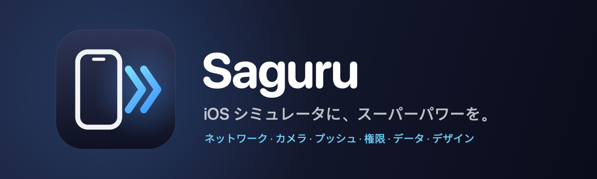
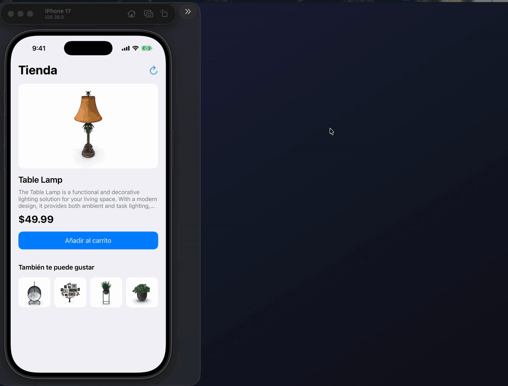
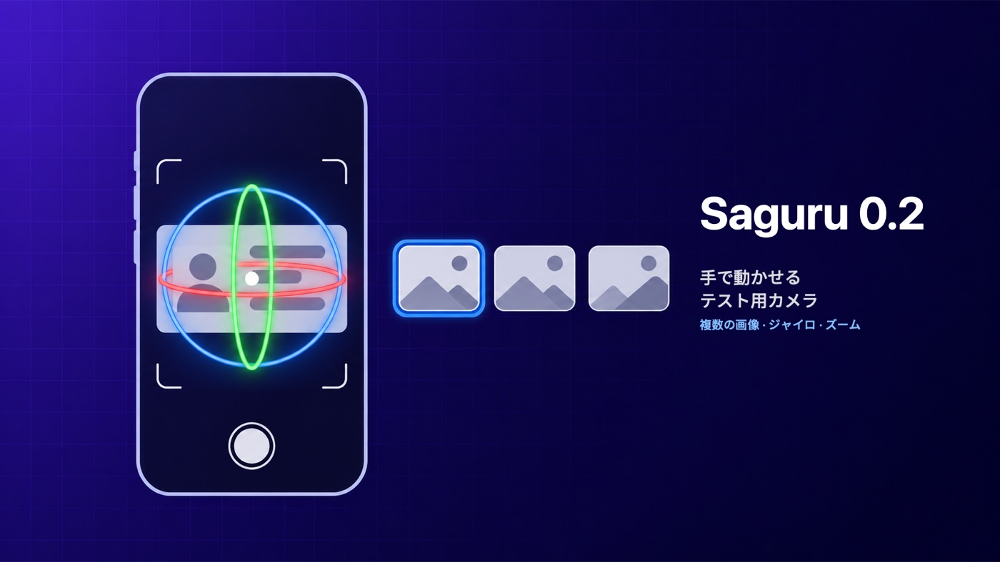
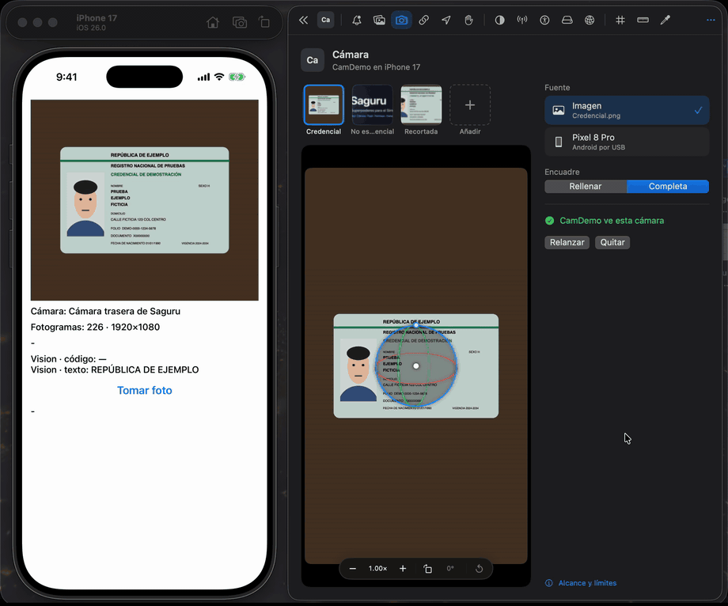
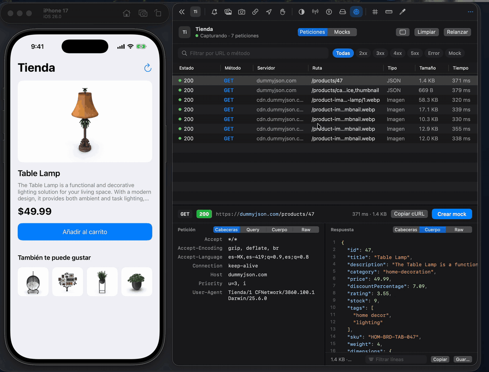
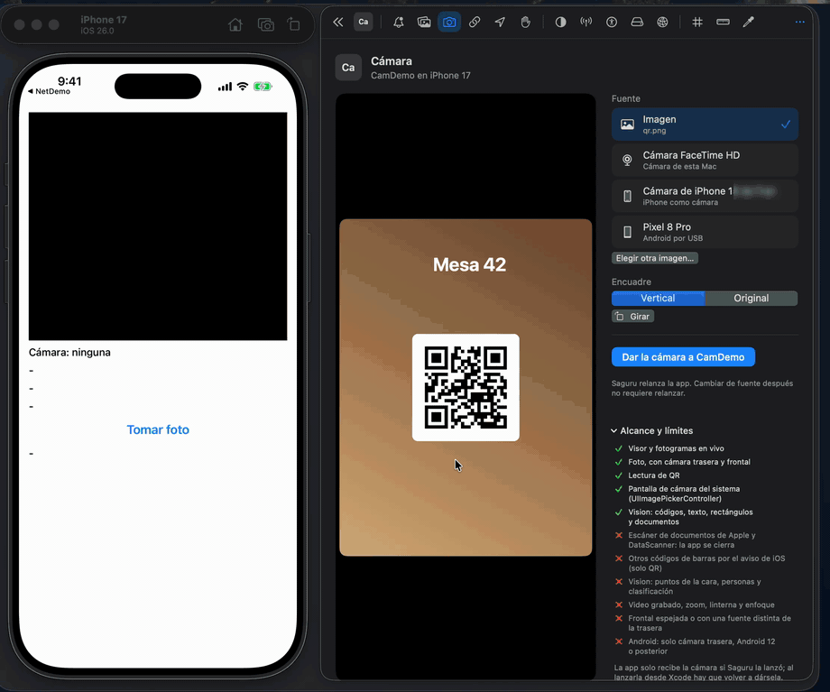
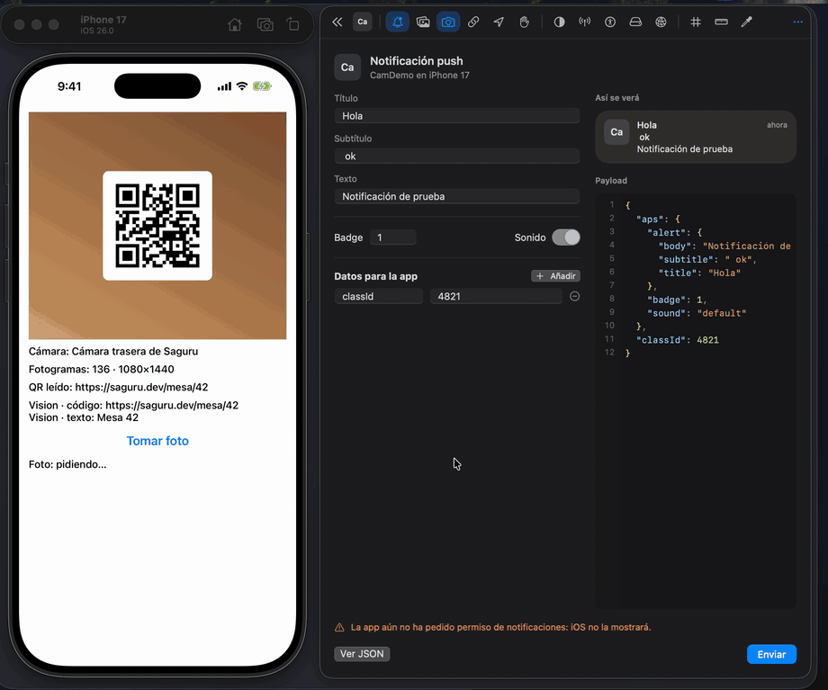
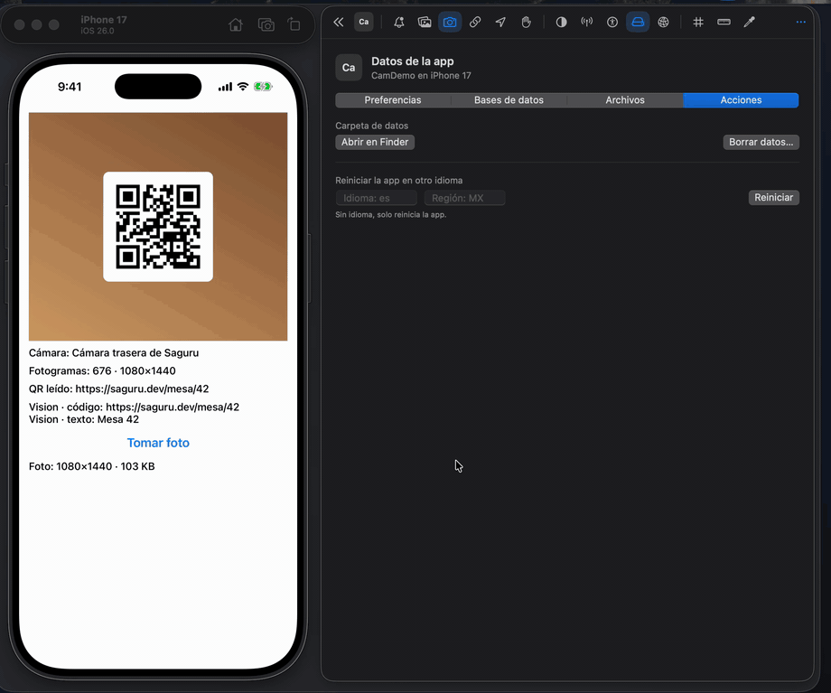
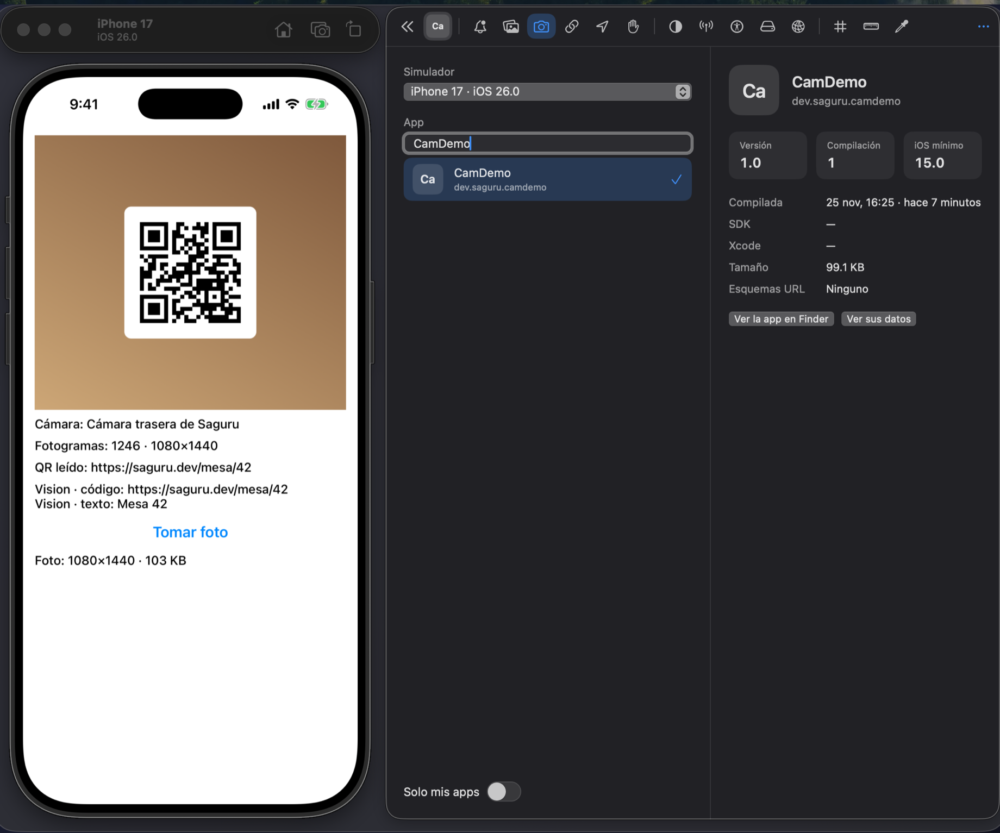

<p align="center">
  
</p>

<p align="center">
  <a href="README.md">Español</a> · <a href="README.en.md">English</a> · <a href="README.zh-CN.md">简体中文</a> · <a href="README.ja.md">日本語</a>
</p>

<p align="center">
  <b>アプリの通信を見て、カメラを与え、通知を送り、ピクセル単位で測る。</b><br>
  すべて iOS シミュレータに寄り添うパネルから。プロキシも証明書も不要で、プロジェクトに手を加える必要もありません。
</p>

<p align="center">
  macOS 14+ · Xcode · MIT ライセンス · 無料・オープンソース
</p>

---

**Saguru**（探る）は、iOS シミュレータのウインドウに寄り添うパネルと、同じ操作ができる CLI です。ふだんは複数のツールや証明書つきのプロキシ、あるいは実機が必要になる作業を、ひとつの場所にまとめます。

> インターフェイスはスペイン語、英語、簡体字中国語、日本語に対応しています。システムの言語に従い、`…` メニューから切り替えられます。以下の録画はスペイン語の画面です。

<p align="center">
  
</p>

## 0.2 の新機能：手で動かせるテスト用カメラ

<p align="center">
  
</p>

撮影フローのテストといえば、身分証を印刷し、端末を構え、傾け、光を探し、またやり直す、の繰り返しでした。Saguru 0.2 なら、座ったまま数秒で済みます。

- **ケースごとに 1 枚。**正しい身分証、身分証ではないもの、切れてしまったものを読み込みます。クリック（または ⌘1…⌘9）で切り替えると、アプリは再起動なしですぐに受け取ります。
- **画像の上のジャイロ。**青いリングで回転、リングの内側をドラッグして遠近の傾き、中心で移動。手で端末を動かすのと同じことを、何度でも再現できます。
- **ズーム**：ボタンまたはピンチで近づけたり遠ざけたり。
- **実機と同じように振る舞うカメラ。**preset に応じたサイズ、YUV フレーム、接続ごとの回転とミラー、写真撮影のすべての通知。実際の身分証撮影フローでテスト済みです。

<p align="center">
  
</p>

> **初回起動時**には、4 ステップの紹介が表示されます。ツールに広さが必要なとき（ネットワーク、ログ、アプリのデータ）は、拡大ボタンで Saguru を全画面にでき、シミュレータは片側に組み込まれます。元に戻すと、シミュレータも元の位置に戻ります。

## Saguru を選ぶ理由

- **アプリに手を加えません。** SDK の組み込みもコードの追加も不要です。アプリの内部で動く必要があるもの（ネットワークとカメラ）は、Saguru がアプリを起動するときにだけ、しかもシミュレータ上でだけ読み込まれます。
- **プロキシも証明書も不要。** 通信はアプリの内側から見るので、ルート証明書を入れたりシステム設定を変えたりせずに、HTTPS の中身をそのまま読めます。
- **カメラのない場所にカメラを。** シミュレータにはカメラがありません。Saguru はアプリにカメラを与え、映すものはあなたが選べます。QR コード、書類、Mac のカメラ、iPhone、Android 端末。
- **作業する場所にいます。** シミュレータの横に `»` ボタン。必要なときに開き、不要なときは畳みます。
- **CLI でもあります。** 同じ操作をスクリプトや CI から使えます。

## インストール

```bash
git clone https://github.com/fsaldivar-dev/saguru.git
cd saguru
scripts/build.sh --install
saguru
```

`build/Saguru.app` を作成し、`saguru` コマンドを `/usr/local/bin` または `~/.local/bin` にリンクします。macOS 14 以降と Xcode が必要です。起動するとシミュレータの横に `»` が現れます。Dock アイコンはなく、`saguru quit` またはパネルの `…` メニューから終了します。

## できること

### ネットワーク：アプリがサーバに送るものを見て、差し替える

各リクエストのメソッド、ステータス、所要時間、サイズ。リクエストとレスポンスを並べて表示し、ヘッダ、クエリ、ボディを確認できます。行番号つきで色分けされた JSON、テキスト、画像、バイナリに対応。生の HTTP 表示、行フィルタ、「cURL をコピー」もあります。

**モックを作成**すると、捕捉したリクエストが保存済みのレスポンスになります。ひとつの HTTP ドキュメントとして編集でき、ステータスコードとヘッダは補完が効き、再起動なしで次のリクエストから適用されます。

<p align="center">
  
</p>

### ログ：Xcode の外では失われるコンソール

Saguru からアプリを起動すると、アプリの出力（`print`、`NSLog`）と、システムが記録したエラーを、フィルタやコピーつきで見られます。アプリが終了した場合は、macOS が書き出すレポートを探し、障害の種類、メッセージ（`Fatal error: …`、捕捉されなかった例外）、スタックを、自分のコードを目立たせて表示します。Xcode もコンソールアプリも不要です。

### カメラ：シミュレータに欠けているもの

画像、Mac のカメラ、iPhone、USB 接続の Android 端末から選ぶと、アプリはそれを自分のカメラとして扱います。ライブプレビュー、Vision や OCR に渡すフレーム、QR の読み取り、写真撮影、前面・背面カメラ、そしてシステムのカメラ画面。ソースを切り替えてもアプリの再起動は不要です。

ケースごとに 1 枚ずつ用意して（身分証、身分証ではないもの、切れているもの）、アプリを動かしたままクリックまたは ⌘1…⌘9 で切り替えられます。画像の上には 3D エディタのようなジャイロがあり、青いリングで回転、内側をドラッグして遠近の傾き、中心で移動します。ズームは下にあります。これらはライブカメラにも適用されます。

<p align="center">
  
</p>

**ケーブルで iPhone を使う。Wi-Fi も iCloud も不要。**Apple の連係カメラは、iPhone と Mac で同じ iCloud アカウントが必要です。Saguru には、アカウントのいらない方法が 2 つあります。

- **何もインストールしない：iPhone の画面。**ケーブルをつなぎ、「信頼」をタップして、iPhone でカメラアプリを開きます。パネルに「Pantalla de（あなたの iPhone）」が現れ、Saguru は QuickTime と同じ方法で画面を受け取り、ボタンを除いたファインダー部分だけを切り出します。iOS で許される範囲では、これが Android に最も近いやり方です。iPhone はインストールされたアプリ以外を実行できません。
- **カメラを直接：Saguru Cámara アプリ。**画面を経由せずにカメラの映像を送り、パネルから背面・前面を選べます。`scripts/install-companion.sh <TEAM_ID>` で一度インストールすると、「iPhone por USB」として表示されます。

ツールを開いたままカメラ、iPhone、Android 端末を接続すると、自動的に一覧に現れて「新規」と表示されます。Android 側で USB デバッグの許可がまだなら、Saguru がその場で知らせます。

<p align="center">
  
</p>

あわせて Saguru は、標準では何も返さないシミュレータ上の Vision で、バーコードを読めるようにします。

### そのほかも、同じパネルに

<p align="center">
  
</p>

| | ツール | 内容 |
|---|---|---|
| 注入 | **プッシュ通知** | タイトル、サブタイトル、本文、バッジ、サウンド、独自データ。通知のプレビューとペイロードをその場で確認できます。JSON 表示で編集したり `.apns` を開いたりできます。アプリに権限がない場合は送信前に知らせます |
| | **ギャラリー** | シミュレータの写真とビデオ：追加（ボタンまたはドラッグ）、複数選択、Finder への書き出し、削除 |
| | **ディープリンク** | URL とディープリンクを開きます。アプリが宣言するスキームとドメインを表示し、お気に入りと履歴をアプリごとに保存します |
| | **位置情報** | 地図をクリックして地点を選択。場所の検索と座標の編集もできます |
| | **権限** | アプリが宣言する権限と実際の状態を表で表示：確認、制限つき、許可、許可しない |
| デバイス | **外観** | ライトまたはダーク。「比較」では両方を同時に表示し、ハンドルでスライドできます |
| | **ステータスバー** | 時刻、Wi‑Fi、モバイル通信、データ種別、バッテリー。プレビューつき。「カタログ値」は 9:41 とすべて満タンにします |
| | **アクセシビリティ** | VoiceOver の順序でのナビゲータ、識別子つきの要素ツリー、スコアつきの監査、各種設定（文字サイズ、コントラスト、視差効果、スローアニメーションなど） |
| | **アプリのデータ** | 編集できる User Defaults、クエリできる SQLite データベース（Core Data、SwiftData）、コンテナ内のファイル、データの消去、別の言語での再起動 |
| デザイン | **グリッド** | グリッドとレイアウト用のカラム。デザインツールのように階層ごとに間隔を測ります |
| | **ルーラー** | カーソルの座標と、距離を測るためのガイド。アプリの操作を妨げません |
| | **カラー** | 画面のパレット、アプリのカタログにある名前つきカラー、スポイト。クリックで SwiftUI の `Color` をコピーします |

<p align="center">
  
</p>

### 目の前のアプリが何かを教えてくれるホーム

パネルはホームから始まります。ここで、すべてのツールが対象とするアプリを選び（検索つき、シミュレータごとに記憶）、その情報を確認できます。バージョン、**ビルド番号**、最小 iOS、ビルド日時、SDK、サイズ、URL スキーム。アクセシビリティの権限がなければ、その場で求め、用途も説明します。

<p align="center">
  
</p>

## CLI

同じ操作を、ターミナルとスクリプトから：

```bash
saguru devices
saguru apps
saguru push com.example.app -t "Order on its way" -b "Arrives in 10 minutes"
saguru push com.example.app --payload payload.json
saguru media photo.jpg video.mp4
saguru url myapp://profile/42
saguru location 19.4326 -99.1332        # or: saguru location clear
saguru privacy grant photos com.example.app
saguru appearance toggle
saguru statusbar clean                  # or: reset
saguru textsize accessibility-large     # or: increment / decrement
saguru contrast on
saguru data open com.example.app
saguru data erase com.example.app --yes
saguru defaults com.example.app
saguru defaults com.example.app onboardingSeen true --type bool
saguru relaunch com.example.app --lang en --region US
saguru query com.example.app "SELECT * FROM ZUSER LIMIT 10" --db default.store
```

複数のシミュレータが起動している場合は、`-d "iPhone 17"`（名前または UDID）でひとつを指定する必要があります。Saguru は推測しません。

## 仕組み

- 各操作は `xcrun simctl` を通して行います。プライベートフレームワークは使っていません。
- ネットワークとカメラは、アプリが Saguru のエージェントを読み込んだ状態で起動する必要があります（`agent/` にあり、`DYLD_INSERT_LIBRARIES` で読み込みます。プロジェクトには何も追加されません）。両者は一度の起動を共有するので、片方を有効にしてももう片方は失われません。アプリが閉じられたり別の場所から起動されたりすると、Saguru が知らせます。
- ネットワークのエージェントは `URLSession` のリクエストを見て、Saguru が読む一時フォルダに書き出し、有効なモックで応答します。モックはアプリごとに `~/Library/Application Support/Saguru/mocks/` に保存されます。
- カメラのエージェントはアプリ内で欠けているカメラの代わりを務め、メモリマップしたファイルを通じて Saguru からフレームを受け取ります。
- デザインツールとインスペクタは、macOS のアクセシビリティ API を使って、シミュレータのウインドウ内でデバイスの画面がどこにあるかを調べます。

## 既知の制限

Saguru は、できないことをはっきり伝えることを選びます。完全な一覧は[スペイン語の README](README.md#límites-conocidos) にあります。主なものは次のとおりです。

- **ネットワーク：**`URLSession` を通るものだけが対象です（Alamofire なども含む）。gRPC、WebSocket、`WKWebView`、独自ソケットは見えません。モックはメソッドと URL で一致させ、クエリは見ません。
- **カメラ：**`AVCaptureSession` と `UIImagePickerController` に対応します。フレームは実機と同じ形で届きます。セッションの preset のサイズ（4K は 1080p で提供）、アプリが接続を回転させない限り横向き、アプリが指定したピクセル形式で、フロントカメラはプレビューで鏡像になります。Apple の書類スキャナ（VisionKit）と `DataScanner` には対応しておらず、カメラが有効な状態で書類スキャナを開くとアプリが落ちます。iOS 標準のコード検出が返すのは QR だけです。動画の録画はできません。ズーム、ライト、フォーカスは設定できますが、映像は変わりません。個別に実装していないカメラのメソッドは、アプリを落とす代わりに空の値を返し、ログに一度だけ `Saguru camera: … has no stand-in` と記録します。
- **Android をソースにする場合：**`adb`、USB デバッグ、Android 12 以降が必要です。背面カメラのみ。
- **シミュレータ上の Vision：**バーコード、テキスト、矩形、書類は動きます。顔のランドマーク、人物、画像分類は、シミュレータで動くバージョンがありません。
- **起動：**ネットワークの監視とカメラが使えるのは、Saguru が起動したアプリだけです。Xcode から起動した場合は、もう一度有効にする必要があります。
- **権限：**デザインツールには macOS のアクセシビリティ権限が必要です。

**あなたのアプリがこれらの制限に当たった、または一覧にない問題を見つけた場合は、**[issue を作成](https://github.com/fsaldivar-dev/saguru/issues/new)して、使っている API と期待した動作を教えてください。カメラの場合は、アプリのログにある `Saguru camera:` の行も貼ってください。それをもとに、次に何を拡張するかを決めます。

## ライセンス

[MIT](LICENSE)。Android 端末をカメラとして使うために、[scrcpy](https://github.com/Genymobile/scrcpy) のサーバ（Apache 2.0 ライセンス、`vendor/scrcpy`）を同梱しています。

**商標について。**Saguru は独立したプロジェクトであり、Apple および Google とは提携しておらず、その承認も受けていません。iPhone、iOS、Xcode、Mac は Apple Inc. の商標、Android と Pixel は Google LLC の商標です。Saguru が何と連携するかを説明するためにのみ記載しています。デモに登場する身分証は架空のものです。

**データについて。**Saguru はどのサーバーにも何も送信しません。ネットワークモニタは取得した内容（ヘッダと本文、そこに含まれるトークンも）を Mac の一時フォルダに、モックを `~/Library/Application Support/Saguru` に保存します。マシンを共有する場合は削除してください。
