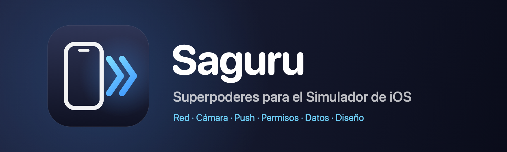
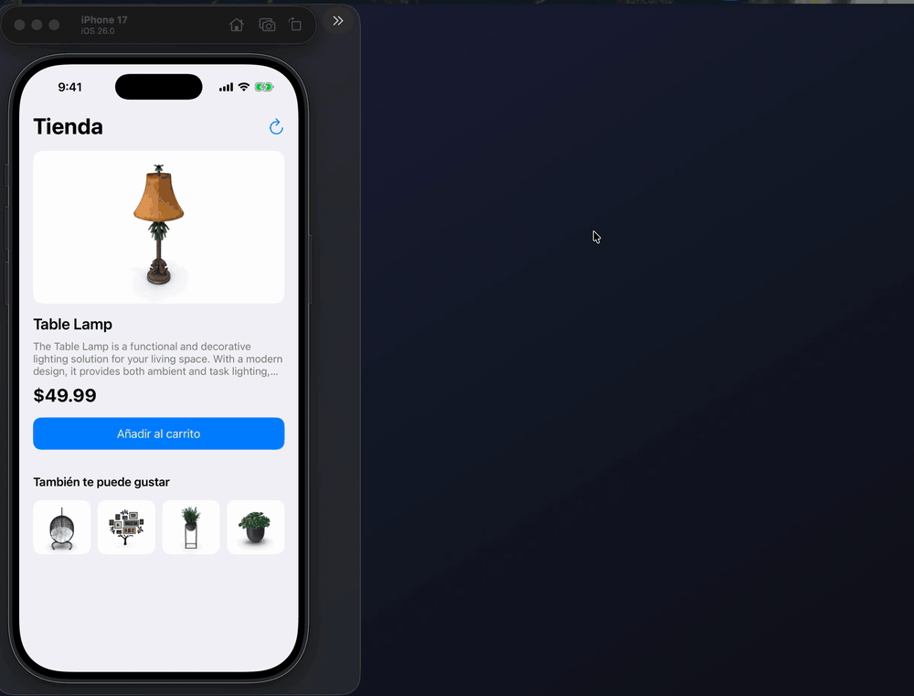
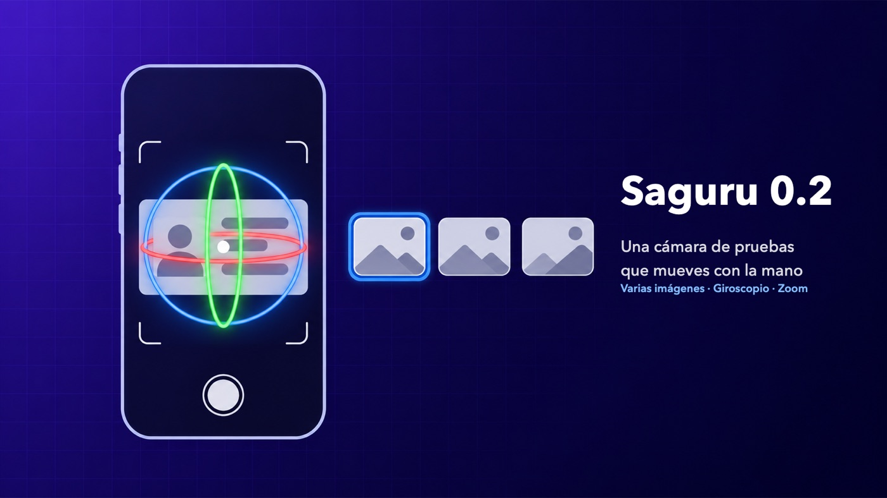
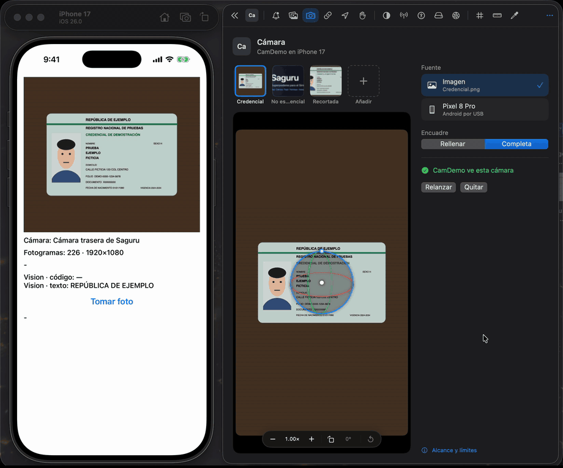
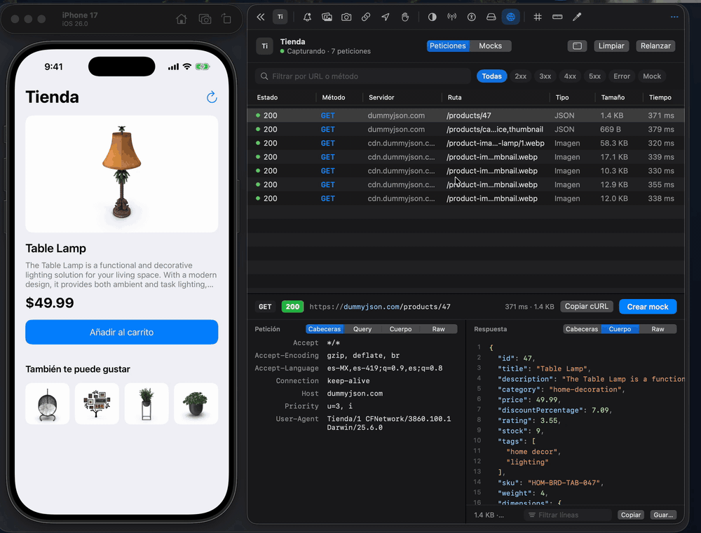
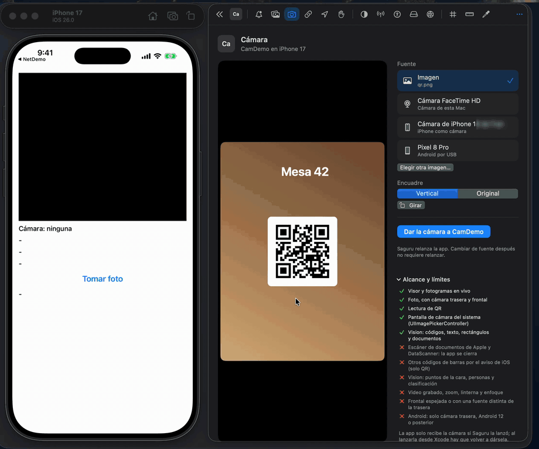
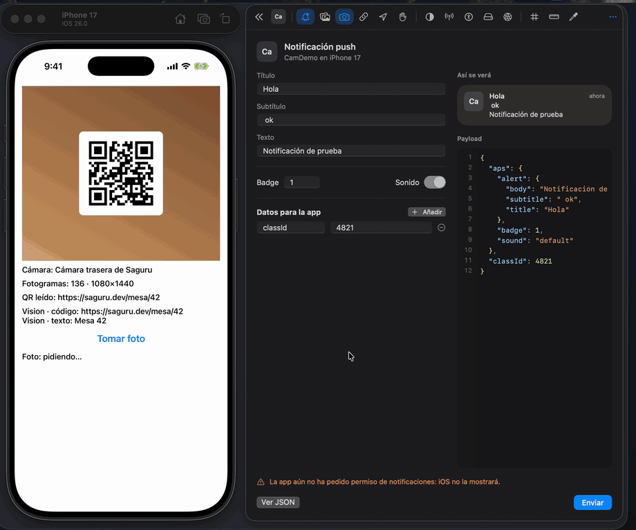
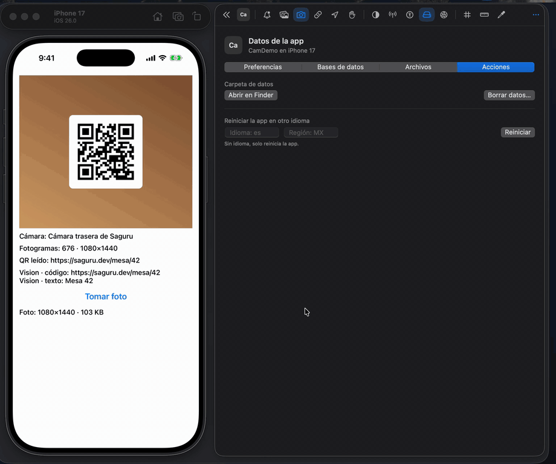
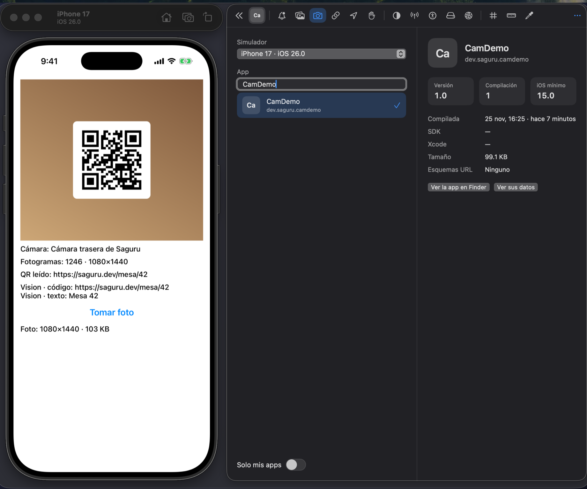

<p align="center">
  
</p>

<p align="center">
  <a href="README.md">Español</a> · <a href="README.en.md">English</a> · <a href="README.zh-CN.md">简体中文</a> · <a href="README.ja.md">日本語</a>
</p>

<p align="center">
  <b>Mira la red de tu app, dale una cámara, mándale notificaciones y mídela al píxel.</b><br>
  Todo desde un panel pegado al Simulador de iOS. Sin proxy, sin certificados y sin tocar tu proyecto.
</p>

<p align="center">
  macOS 14+ · Xcode · Licencia MIT · Gratis y abierto
</p>

---

**Saguru** (探る, «sondear») es un panel que se acopla a la ventana del Simulador de iOS y un CLI con las mismas
acciones. Reúne en un solo sitio lo que normalmente pide varias herramientas, un proxy con certificados o un
dispositivo real.

<p align="center">
  
</p>

## Nuevo en 0.2: una cámara de pruebas que mueves con la mano

<p align="center">
  
</p>

Probar un flujo de captura siempre fue lo mismo: imprimir la credencial, sostener el teléfono, inclinarlo, buscar
luz, repetir. Con Saguru 0.2 lo haces sentado, y en segundos:

- **Un caso por imagen.** Carga la credencial buena, la que no es una credencial y la que salió cortada. Cambias de
  una a otra con un clic (o ⌘1…⌘9) y tu app la recibe al instante, sin relanzar.
- **Un giroscopio sobre la imagen.** El anillo azul la gira, arrastrar por dentro la inclina en perspectiva y el
  centro la mueve. Es lo que haría tu mano con el teléfono, pero repetible.
- **Zoom para acercarte o alejarte**, con botones o pellizcando.
- **Una cámara que se comporta como la de un teléfono.** Tamaño del preset, fotogramas en YUV, giro y espejo de cada
  conexión, y todos los avisos de una foto. Probada con un flujo real de captura de identificaciones.

<p align="center">
  
</p>

## Por qué Saguru

- **No toca tu app.** No hay SDK que integrar ni código que añadir. Lo que necesita estar dentro de la app (red y
  cámara) se carga solo cuando Saguru la lanza, y solo en el simulador.
- **Sin proxy ni certificados.** La red se ve desde dentro de la app, así que el HTTPS se lee tal cual, sin instalar
  un certificado raíz ni configurar el sistema.
- **Una cámara donde no la hay.** El simulador no tiene cámara. Saguru le da una a tu app, con la imagen que tú
  elijas: un QR, un documento, la cámara de tu Mac, tu iPhone o un Android.
- **Vive donde trabajas.** Un botón `»` junto al Simulador. Lo despliegas cuando lo necesitas y lo pliegas cuando no.
- **También es un CLI.** Las acciones sirven para scripts y para integración continua.

## Instalar

```bash
git clone https://github.com/fsaldivar-dev/saguru.git
cd saguru
scripts/build.sh --install
saguru
```

Crea `build/Saguru.app` y enlaza el comando `saguru` en `/usr/local/bin` o `~/.local/bin`. Requiere macOS 14 o
posterior y Xcode. Al abrirlo aparece un `»` junto al Simulador; no tiene icono en el Dock y se cierra con
`saguru quit` o desde el menú `…` del panel.

## Qué hace

### Red: mira y sustituye lo que tu app le pide al servidor

Cada petición con su método, estado, tiempo y tamaño. Petición y respuesta lado a lado, con cabeceras, parámetros
y cuerpo: JSON coloreado y con números de línea, texto, imágenes y binarios. Vista del mensaje HTTP crudo, filtro de
líneas y «Copiar cURL».

Con **Crear mock**, una petición capturada se convierte en una respuesta guardada. Se edita como un único documento
HTTP, con autocompletado de códigos de estado y cabeceras, y se aplica en la siguiente petición sin relanzar.

<p align="center">
  
</p>

### Cámara: lo que el simulador no tiene

Elige una imagen, la cámara de tu Mac, un iPhone o un Android por USB, y tu app la ve como si fuera su cámara: visor
en vivo, fotogramas para Vision y OCR, lectura de QR, foto, cámara frontal y trasera, y la pantalla de cámara del
sistema. Cambiar de fuente no requiere relanzar la app. Saguru encuadra la imagen al tamaño que pide tu app, rellenando el cuadro o
mostrándola completa.

Prepara un caso por imagen (una identificación, algo que no lo es, una recortada) y cambia de una a otra con un
clic o con ⌘1…⌘9 mientras la app sigue abierta. Sobre la imagen hay un giroscopio, como el de un editor 3D: el
anillo azul la gira, arrastrar por dentro la inclina en perspectiva y el centro la mueve; abajo tienes el zoom.
Todo eso también se aplica a las cámaras en vivo.

<p align="center">
  
</p>

Si conectas una cámara, un iPhone o un Android con la herramienta abierta, aparece sola en la lista, marcada como nueva; si al Android le falta aceptar la depuración USB, Saguru te lo dice ahí mismo.

<p align="center">
  
</p>

De paso, Saguru hace que Vision lea códigos de barras en el simulador, donde por defecto no devuelve nada.

### Todo lo demás, en el mismo panel

<p align="center">
  
</p>

| | Herramienta | Qué hace |
|---|---|---|
| Inyectar | **Notificación push** | Título, subtítulo, texto, badge, sonido y datos propios, con vista previa del aviso y el payload en vivo. Vista JSON para editarlo o abrir un `.apns`. Avisa antes de enviar si la app no tiene permiso |
| | **Galería** | Las fotos y videos del simulador: añadir (botón o arrastrando), seleccionar varias, exportar a Finder y eliminar |
| | **Deep links** | Abre URLs y deep links. Muestra los esquemas y dominios que declara la app, y guarda favoritos e historial por app |
| | **Ubicación** | Un mapa donde eliges el punto con un clic, buscador de lugares y coordenadas editables |
| | **Permisos** | Los permisos que la app declara y su estado real, en una cuadrícula: Preguntar, Limitado, Permitir o Nunca |
| Dispositivo | **Apariencia** | Claro u oscuro, y «Comparar»: las dos apariencias a la vez con un tirador para deslizar |
| | **Barra de estado** | Hora, Wi‑Fi, red celular, tipo de datos y batería, con vista previa. «Valores de catálogo» pone 9:41 y todo lleno |
| | **Accesibilidad** | Navegador en el orden de VoiceOver, árbol de elementos con identificadores, auditoría con puntuación y ajustes (texto, contraste, movimiento, animaciones lentas…) |
| | **Datos de la app** | User Defaults editables, bases SQLite (Core Data, SwiftData) con consultas, archivos del contenedor, borrar datos y reiniciar en otro idioma |
| Diseño | **Cuadrícula** | Rejilla y columnas de maquetación, con medidas por jerarquía como en una herramienta de diseño |
| | **Reglas** | Coordenadas del cursor y guías para medir distancias, sin estorbar a la app |
| | **Colores** | La paleta de la pantalla, los colores con nombre del catálogo de la app y un cuentagotas. Un clic copia el `Color` de SwiftUI |

<p align="center">
  
</p>

### Un inicio que te dice qué app tienes delante

El panel se abre en el inicio: ahí eliges la app sobre la que actúa todo (con buscador, y se recuerda por simulador)
y ves su ficha: versión, **número de compilación**, iOS mínimo, cuándo se compiló, SDK, tamaño y esquemas de URL. Si
falta el permiso de Accesibilidad, lo pide ahí mismo y explica para qué sirve.

<p align="center">
  
</p>

## El CLI

Las mismas acciones, para la terminal y para scripts:

```bash
saguru devices
saguru apps
saguru push com.miempresa.miapp -t "Pedido en camino" -b "Llega en 10 minutos"
saguru push com.miempresa.miapp --payload payload.json
saguru media foto.jpg video.mp4
saguru url miapp://perfil/42
saguru location 19.4326 -99.1332        # o: saguru location clear
saguru privacy grant photos com.miempresa.miapp
saguru appearance toggle
saguru statusbar clean                  # o: reset
saguru textsize accessibility-large     # o: increment / decrement
saguru contrast on
saguru data open com.miempresa.miapp
saguru data erase com.miempresa.miapp --yes
saguru defaults com.miempresa.miapp
saguru defaults com.miempresa.miapp onboardingVisto true --type bool
saguru defaults com.miempresa.miapp onboardingVisto --delete
saguru relaunch com.miempresa.miapp --lang en --region US
saguru query com.miempresa.miapp "SELECT * FROM ZUSUARIO LIMIT 10" --db default.store
```

Con varios simuladores arrancados hay que elegir uno con `-d "iPhone 17"` (nombre o UDID); Saguru no adivina.

`push` comprueba que la app esté instalada y avisa si iOS no va a mostrar la notificación porque la app no tiene
permiso de notificaciones (denegado, o nunca lo pidió). `--payload` acepta cualquier JSON de APNs: subtítulo,
sonido, `thread-id`, datos propios.

## Cómo funciona

- Las acciones pasan por `xcrun simctl` (`Simctl.swift`); no se usan frameworks privados.
- La galería lee la fototeca del simulador directamente de sus archivos en esta Mac (solo lectura), y los permisos
  de notificaciones, del archivo donde iOS los guarda.
- El panel localiza la ventana del Simulador con la lista pública de ventanas del sistema y se coloca a su lado.
- La capa de diseño usa la API de Accesibilidad para leer el rectángulo de la pantalla del dispositivo.
- Red y cámara necesitan que la app arranque con el agente dentro, así que comparten un único lanzamiento: lo
  pida la herramienta que lo pida, la app sale con la red vigilada y con la cámara si se le dio alguna vez. Activar
  una no quita la otra, ni tampoco «Reiniciar» desde Datos. Saguru vigila ese proceso: si la app se cierra o se
  lanza desde Xcode o la pantalla de inicio, lo avisa en la herramienta en vez de seguir diciendo que captura.
- La cámara usa el mismo agente (`agent/SaguruCamera.m`): dentro de la app sustituye a la cámara que falta, y recibe
  los fotogramas de Saguru por un archivo que ambos mapean en memoria. `experiments/camera/app.m` y `experiments/network/app.m` son las apps
  mínimas con las que se probó cada caso y se grabaron las demostraciones de este README.
- El monitor de red relanza la app con una pequeña biblioteca dentro (`agent/SaguruAgent.m`, cargada con
  `DYLD_INSERT_LIBRARIES`; nada se añade a tu proyecto). Esa biblioteca ve las peticiones de `URLSession`, las
  escribe en una carpeta temporal que Saguru lee, y responde con los mocks activos. Los mocks se guardan por app en
  `~/Library/Application Support/Saguru/mocks/<bundle id>/`.


Las herramientas de diseño y el inspector necesitan el permiso de **Accesibilidad** de macOS: es la única forma de
saber dónde está la pantalla del dispositivo dentro de la ventana del Simulador. El resto no pide ningún permiso,
salvo el de cámara si eliges la de tu Mac como fuente.

## Límites conocidos

Saguru prefiere decir lo que no hace. Lo mismo aparece dentro de cada herramienta donde importa.

**¿Tu app choca con alguno de estos límites, o encontraste uno que no está en la lista?**
[Abre un issue](https://github.com/fsaldivar-dev/saguru/issues/new) y cuéntanos qué app o qué API usa y qué esperabas; si es de cámara, pega las líneas
`Saguru camera:` del registro. Con eso decidimos qué ampliar primero.

<details>
<summary>Ver la lista completa</summary>

- La cuadrícula combina dos fuentes: los elementos que la app expone a accesibilidad y los contenedores que detecta
  por su fondo en una captura. Un contenedor sin fondo propio (un simple `VStack`) no se ve, y los bordes detectados
  tienen medio punto de margen de error.
- Los nombres de color salen del catálogo de recursos compilado. Los colores definidos en código no conservan nombre.

- Las bases de datos se abren en solo lectura: se consultan, no se modifican. Los cambios en User Defaults los lee
  la app la próxima vez que arranca.

- La hora de la barra de estado debe ir como `9:41`; el simulador rechaza otros formatos y, curiosamente, las horas
  en punto (`12:00`).

- Eliminar fotos reconstruye la fototeca: el simulador no permite borrar una foto suelta, así que Saguru la vacía y
  vuelve a añadir las demás. Se pierden los álbumes, favoritos y ediciones hechos dentro del simulador, y Fotos
  vuelve a mostrar su pantalla de bienvenida.

- El radio de las esquinas de la capa de diseño es aproximado.
- El inspector de accesibilidad lee el árbol que el Simulador expone a macOS, así que necesita el permiso de
  Accesibilidad y que la ventana del Simulador esté en el escritorio actual. VoiceOver no se enciende: el orden y lo
  que «se leería» se deducen del árbol. El contraste de la auditoría es una estimación sobre una captura.
- Los ajustes de accesibilidad que `simctl` no cubre se escriben en las preferencias del simulador. Falta la
  escala de grises: no se pudo confirmar que surta efecto.
- Saguru pide el permiso de Accesibilidad en el inicio del panel si no lo tiene; macOS lo aplica tras relanzar. `scripts/build.sh`
  firma con tu certificado «Apple Development» si existe, y así el permiso sobrevive a las recompilaciones; sin
  certificado la firma es local y macOS lo vuelve a pedir tras cada build.
- El monitor de red solo ve lo que pasa por `URLSession` (también Alamofire y similares). No ve gRPC (Firestore),
  WebSockets, `WKWebView` ni sockets propios. Solo captura si Saguru lanzó la app: al lanzarla desde Xcode hay que
  volver a pulsar Capturar. Un mock responde a un método y una URL sin mirar los parámetros; de cada cuerpo se
  guardan como mucho 8 MB. Las subidas por archivo o stream largo no se han probado.
- La cámara cubre las apps que la manejan con `AVCaptureSession` (cámara trasera y frontal, que muestran la misma
  fuente) y `UIImagePickerController` con la cámara como origen, cuya pantalla se sustituye por una sencilla con la
  imagen en vivo, disparador y cancelar. Los fotogramas llegan como en un teléfono: en el tamaño del preset de la
  sesión (4K se entrega a 1080p), acostados salvo que la app gire la conexión, en el formato de píxel que pida (YUV
  por defecto) y con la frontal espejada en el visor. No están cubiertos el escáner de documentos de VisionKit ni
  `DataScanner`: una app que abra el escáner de documentos con la cámara activa se cierra. El aviso de códigos de
  iOS (`AVCaptureMetadataOutput`) solo entrega QR. No hay video grabado ni profundidad; zoom, linterna, enfoque y
  exposición se aceptan y se recuerdan, pero no cambian la imagen. Los cambios de enfoque o exposición no se
  notifican a quien los observe. Se ha probado con apps de prueba y con un flujo real de captura de
  identificaciones, usando una credencial ficticia; no con todas las formas de usar la cámara.
- La cámara simulada responde con «nada» (nil, cero) a cualquier método de `AVCaptureDevice` y compañía que no
  tenga respuesta propia, en vez de cerrar la app, y lo anota una vez en el registro de la app:
  `Saguru camera: -[AVCaptureDevice …] has no stand-in`. Si tu app se comporta raro con la cámara, busca esas líneas. Un
  Android como fuente necesita `adb`, depuración USB y Android 12 o posterior; usa su cámara trasera. El video lo
  entrega el servidor de scrcpy, que va incluido en Saguru (`vendor/scrcpy`, licencia Apache 2.0). La app solo recibe
  la cámara si Saguru la lanzó.
- Vision en el simulador: las versiones nuevas de algunos detectores no funcionan ahí. Con el agente cargado
  (`agent/SaguruVision.m`), las peticiones de códigos de barras y de caras se pasan a una versión anterior que sí
  funciona; texto, rectángulos y documentos ya funcionaban. Puntos de la cara, personas y clasificación de imágenes
  no tienen versión que funcione en el simulador y siguen fallando. La API nueva de Vision en Swift (iOS 18) no se
  ha probado.
- Fuera de alcance por ahora: captura de pantalla o video (ya lo hace el Simulador).


</details>

## Licencia

[MIT](LICENSE). Incluye el servidor de [scrcpy](https://github.com/Genymobile/scrcpy), con licencia Apache 2.0
(`vendor/scrcpy`), para usar un Android como cámara.
