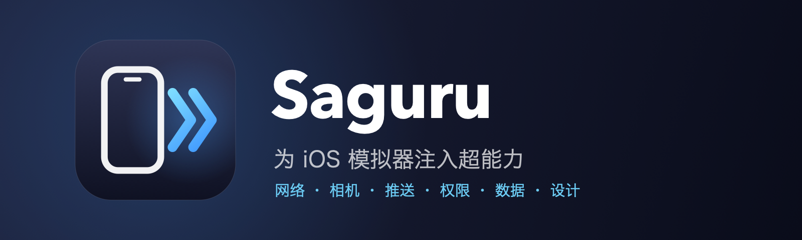
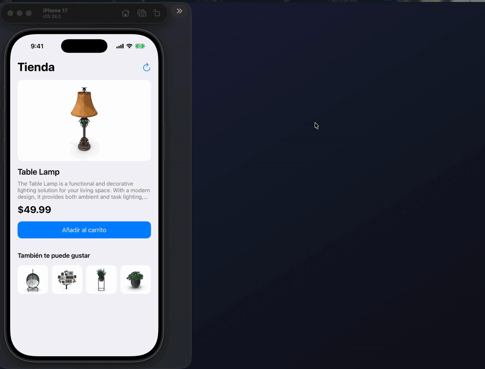
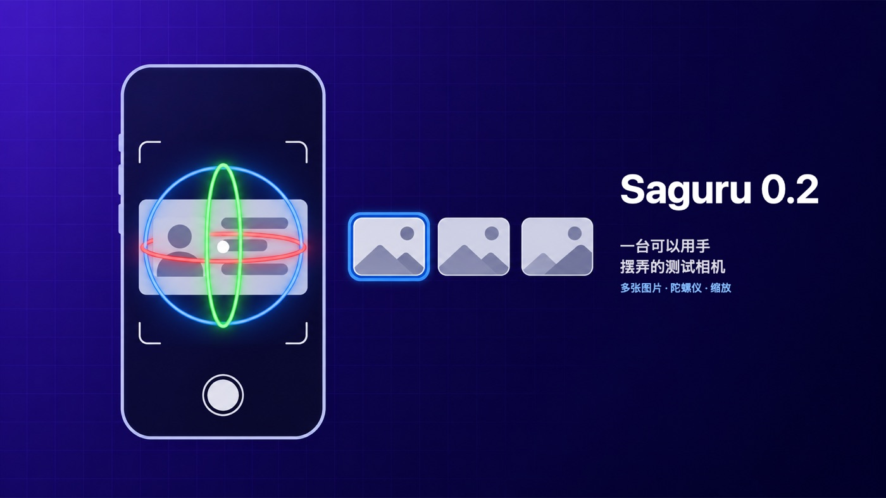
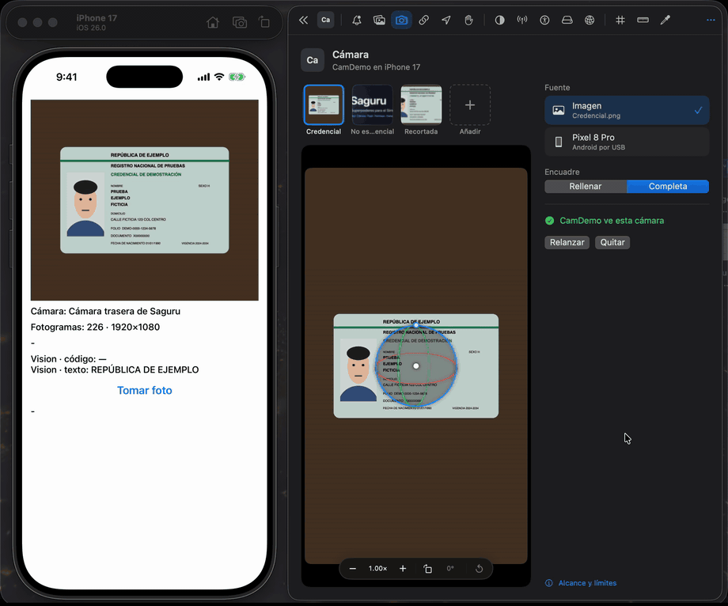
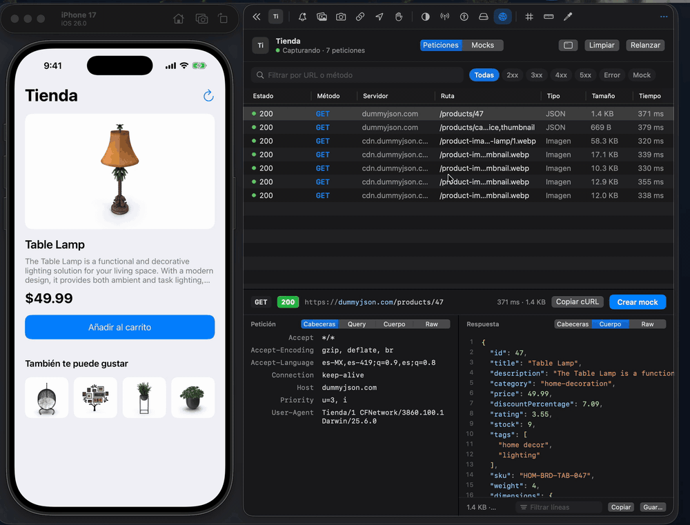
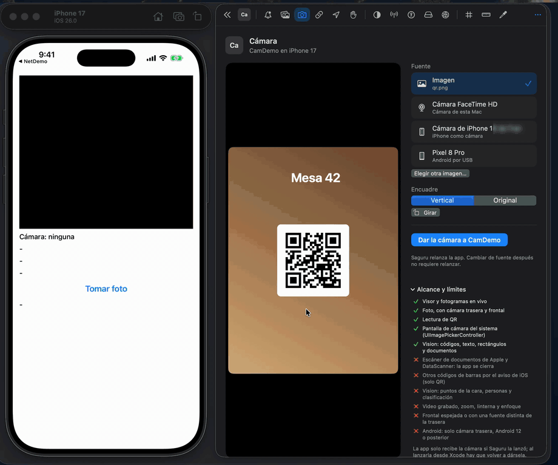
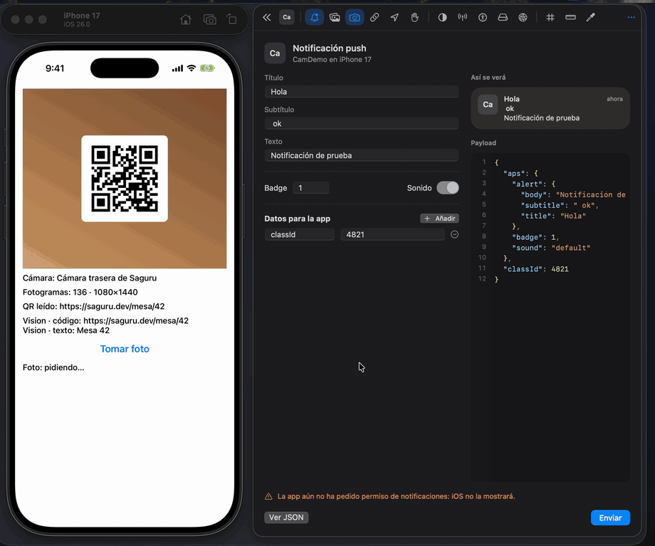
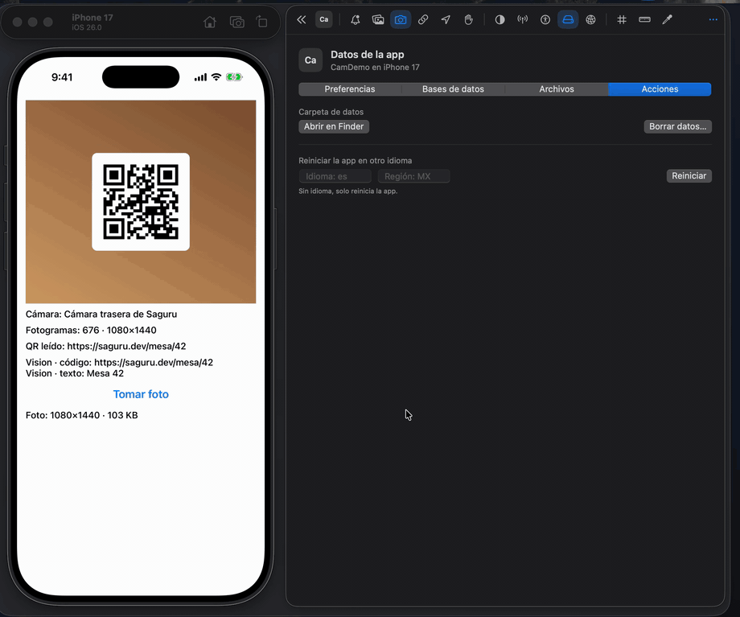
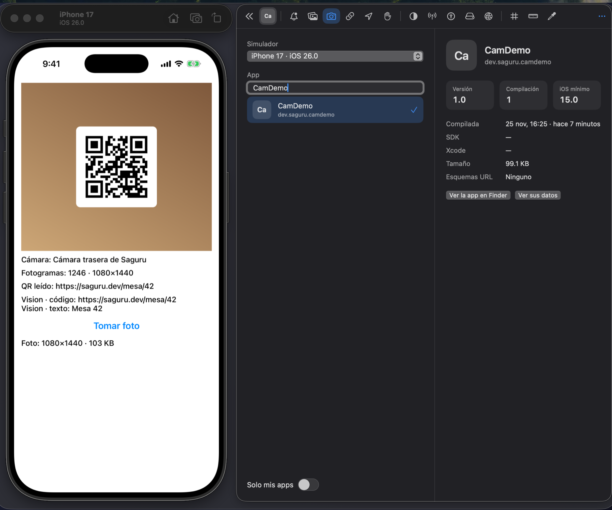

<p align="center">
  
</p>

<p align="center">
  <a href="README.md">Español</a> · <a href="README.en.md">English</a> · <a href="README.zh-CN.md">简体中文</a> · <a href="README.ja.md">日本語</a>
</p>

<p align="center">
  <b>查看应用的网络请求，给它一个相机，向它发送通知，并精确到像素地测量界面。</b><br>
  一切都在一个停靠于 iOS 模拟器旁的面板中完成。无需代理，无需证书，也不必改动你的项目。
</p>

<p align="center">
  macOS 14+ · Xcode · MIT 许可证 · 免费开源
</p>

---

**Saguru**（探る，意为“探查”）是一个停靠在 iOS 模拟器窗口旁的面板，并附带功能相同的命令行工具。它把通常需要多个工具、带证书的代理或真机才能完成的事情集中到了一处。

> 界面提供西班牙语、英语、简体中文和日语，默认跟随系统语言，也可以在 `…` 菜单中切换。下面的录屏是西班牙语界面。

<p align="center">
  
</p>

## 0.2 新功能：一台可以用手摆弄的测试相机

<p align="center">
  
</p>

测试拍摄流程以前总是这样：打印证件、举着手机、倾斜、找光线，然后再来一遍。有了 Saguru 0.2，你坐着就能完成，只需几秒：

- **一张图片对应一种情况。**加载合格的证件、不是证件的东西，以及被裁切的证件。点击一下（或按 ⌘1…⌘9）即可切换，应用立刻收到，无需重新启动。
- **图片上的陀螺仪。**蓝色圆环用于旋转，在环内拖动可做透视倾斜，中心点用于移动。这就是你的手对手机所做的动作，只是可以重复。
- **缩放**：用按钮或双指捏合来拉近、拉远。
- **行为与真机一致的相机。**按 preset 提供尺寸、YUV 帧、每个连接的旋转与镜像，以及拍照的全部回调。已用真实的证件拍摄流程测试过。

<p align="center">
  
</p>

> **首次使用时**，Saguru 会用四步引导向你介绍自己。当某个工具需要更多空间（网络、日志、应用数据）时，点击展开按钮即可让 Saguru 全屏显示，模拟器嵌在一侧；收起后，模拟器回到原来的位置。

## 为什么选择 Saguru

- **不改动你的应用。** 无需集成 SDK，也无需添加代码。必须运行在应用内部的部分（网络与相机）只在 Saguru 启动应用时加载，并且只在模拟器中生效。
- **无需代理和证书。** 网络是从应用内部观察的，因此 HTTPS 内容可以直接读取，不必安装根证书或修改系统设置。
- **在没有相机的地方提供相机。** 模拟器没有相机。Saguru 为你的应用提供一个，画面由你决定：二维码、文档、Mac 的摄像头、你的 iPhone 或 Android 手机。
- **就在你工作的地方。** 模拟器旁有一个 `»` 按钮，需要时展开，不需要时收起。
- **同时也是命令行工具。** 同样的操作可用于脚本和持续集成。

## 安装

```bash
git clone https://github.com/fsaldivar-dev/saguru.git
cd saguru
scripts/build.sh --install
saguru
```

会生成 `build/Saguru.app`，并把 `saguru` 命令链接到 `/usr/local/bin` 或 `~/.local/bin`。需要 macOS 14 或更高版本以及 Xcode。启动后，模拟器旁会出现一个 `»`；它没有 Dock 图标，可通过 `saguru quit` 或面板的 `…` 菜单退出。

## 功能

### 网络：查看并替换应用向服务器发出的请求

每个请求的方法、状态码、耗时和大小。请求与响应并排显示，包含请求头、查询参数和正文：带行号的彩色 JSON、文本、图片和二进制数据。还有原始 HTTP 视图、按行过滤和“复制 cURL”。

通过 **创建 Mock**，可以把捕获到的请求变成一份保存的响应。它以单个 HTTP 文档的形式编辑，状态码和请求头支持自动补全，并在下一次请求时生效，无需重启应用。

<p align="center">
  
</p>

### 日志：离开 Xcode 就看不到的控制台

从 Saguru 启动应用，就能看到它输出的内容（`print`、`NSLog`）以及系统为它记录的错误，支持筛选和复制。如果应用退出，Saguru 会找到 macOS 写下的报告，显示故障类型、信息（`Fatal error: …`、未捕获的异常）和调用栈，并突出显示你自己的代码。无需打开 Xcode 或“控制台”应用。

### 相机：模拟器所缺少的

选择一张图片、Mac 的摄像头、一部 iPhone 或通过 USB 连接的 Android 手机，你的应用就会把它当作自己的相机：实时预览、供 Vision 与 OCR 使用的画面帧、二维码识别、拍照、前后摄像头，以及系统相机界面。切换画面来源无需重启应用。

为每种情况准备一张图片（证件、非证件、被裁切的证件），在应用保持运行的情况下通过点击或 ⌘1…⌘9 切换。图片上有一个陀螺仪，就像 3D 编辑器里的那种：蓝色圆环用于旋转，在环内拖动可做透视倾斜，中心点用于移动；缩放在下方。这些同样适用于实时相机。

<p align="center">
  
</p>

**通过数据线使用 iPhone，无需 Wi-Fi 和 iCloud。**Apple 的连续互通相机要求 iPhone 和 Mac 登录同一个 iCloud 账户。Saguru 提供两种不需要账户的方式：

- **无需安装任何东西：iPhone 的屏幕。**接上数据线，点“信任”，在手机上打开相机应用。面板中会出现“Pantalla de（你的 iPhone）”：Saguru 像 QuickTime 一样接收屏幕画面，并裁剪到取景区域，去掉按钮。这是 iOS 所允许的最接近 Android 的做法：iPhone 不会运行未安装的程序。
- **直接取相机画面：Saguru Cámara 应用。**它不经过屏幕，直接提供相机画面，并可在面板中选择后置或前置摄像头。用 `scripts/install-companion.sh <TEAM_ID>` 安装一次后，会显示为“iPhone por USB”。

在工具打开时接入摄像头、iPhone 或 Android 手机，它会自动出现在列表中并标记为“新”；如果 Android 手机还没有允许 USB 调试，Saguru 会直接在那里提示。

<p align="center">
  
</p>

此外，Saguru 还让 Vision 能在模拟器中识别条码，而默认情况下它不会返回任何结果。

### 其余功能，都在同一个面板里

<p align="center">
  
</p>

| | 工具 | 功能 |
|---|---|---|
| 注入 | **推送通知** | 标题、副标题、正文、角标、声音和自定义数据，带通知预览和实时 payload。可在 JSON 视图中编辑或打开 `.apns` 文件。应用没有通知权限时会在发送前提醒 |
| | **相册** | 模拟器中的照片和视频：添加（按钮或拖放）、多选、导出到访达、删除 |
| | **Deep link** | 打开 URL 和 deep link。显示应用声明的 scheme 和域名，并按应用保存收藏与历史 |
| | **定位** | 在地图上点击即可选点，支持地点搜索和手动编辑坐标 |
| | **权限** | 以表格显示应用声明的权限及其真实状态：询问、受限、允许或从不 |
| 设备 | **外观** | 浅色或深色，以及“对比”：两种外观同时显示，可拖动分隔条 |
| | **状态栏** | 时间、Wi‑Fi、蜂窝网络、数据类型和电量，带预览。“商店截图值”会设为 9:41 且全部满格 |
| | **辅助功能** | 按 VoiceOver 顺序导航、带标识符的元素树、带评分的审查，以及各项设置（字体大小、对比度、动态效果、慢速动画等） |
| | **应用数据** | 可编辑的 User Defaults、可查询的 SQLite 数据库（Core Data、SwiftData）、容器内的文件、清除数据以及以其他语言重启 |
| 设计 | **网格** | 网格与布局列，并像设计工具那样按层级测量间距 |
| | **标尺** | 光标坐标和用于测量距离的参考线，不影响应用的操作 |
| | **颜色** | 屏幕调色板、应用资源目录中的具名颜色，以及取色器。点击即可复制 SwiftUI 的 `Color` |

<p align="center">
  
</p>

### 一个告诉你当前是哪个应用的首页

面板打开后首先是首页：在这里选择所有工具作用的应用（支持搜索，并按模拟器记住），并查看它的信息：版本、**构建号**、最低 iOS 版本、构建时间、SDK、大小和 URL scheme。如果缺少辅助功能权限，会在这里直接请求并说明用途。

<p align="center">
  
</p>

## 命令行

同样的操作，适用于终端和脚本：

```bash
saguru devices
saguru apps
saguru push com.example.app -t "Order on its way" -b "Arrives in 10 minutes"
saguru push com.example.app --payload payload.json
saguru media photo.jpg video.mp4
saguru url myapp://profile/42
saguru location 19.4326 -99.1332        # or: saguru location clear
saguru privacy grant photos com.example.app
saguru appearance toggle
saguru statusbar clean                  # or: reset
saguru textsize accessibility-large     # or: increment / decrement
saguru contrast on
saguru data open com.example.app
saguru data erase com.example.app --yes
saguru defaults com.example.app
saguru defaults com.example.app onboardingSeen true --type bool
saguru relaunch com.example.app --lang en --region US
saguru query com.example.app "SELECT * FROM ZUSER LIMIT 10" --db default.store
```

同时启动多个模拟器时，必须用 `-d "iPhone 17"`（名称或 UDID）指定其中一个；Saguru 不会替你猜。

## 工作原理

- 各项操作通过 `xcrun simctl` 完成；不使用私有框架。
- 网络和相机要求应用在启动时就载入 Saguru 的 agent（位于 `agent/`，通过 `DYLD_INSERT_LIBRARIES` 加载；不会向你的项目添加任何内容）。两者共用一次启动，因此开启其中一个不会使另一个失效；当应用被关闭或从其他地方启动时，Saguru 会提示你。
- 网络 agent 观察 `URLSession` 请求，把它们写入 Saguru 读取的临时文件夹，并用已启用的 Mock 作答。Mock 按应用保存在 `~/Library/Application Support/Saguru/mocks/`。
- 相机 agent 在应用内部充当缺失的相机，并通过内存映射文件接收来自 Saguru 的画面帧。
- 设计工具和检查器使用 macOS 的辅助功能 API 来确定设备屏幕在模拟器窗口中的位置。

## 已知限制

Saguru 宁愿明确说出它做不到的事。完整列表见[西班牙语 README](README.md#límites-conocidos)，主要包括：

- **网络：**只能看到经过 `URLSession` 的请求（包括 Alamofire 等）。不支持 gRPC、WebSocket、`WKWebView` 和原始套接字。Mock 按方法和 URL 匹配，忽略查询参数。
- **相机：**支持 `AVCaptureSession` 和 `UIImagePickerController`。画面帧与真机一致：按会话 preset 的尺寸提供（4K 以 1080p 提供），除非应用旋转连接否则为横向，使用应用请求的像素格式，前置摄像头在预览中镜像显示。不支持 Apple 的文档扫描器（VisionKit）和 `DataScanner`；在相机启用时打开文档扫描器会导致应用崩溃。iOS 自带的码识别只返回二维码。不支持录像；变焦、手电筒和对焦可以设置，但不会改变画面。没有专门实现的相机方法会返回空值而不是让应用崩溃，并在日志中记录一次 `Saguru camera: … has no stand-in`。
- **以 Android 作为来源：**需要 `adb`、USB 调试以及 Android 12 或更高版本；仅支持后置摄像头。
- **模拟器中的 Vision：**条码、文字、矩形和文档可用。人脸特征点、人体和图像分类没有能在模拟器中运行的版本。
- **启动：**只有由 Saguru 启动的应用才能使用网络监视和相机。从 Xcode 启动后需要重新开启。
- **权限：**设计工具需要 macOS 的辅助功能权限。

**你的应用碰到了这些限制，或者发现了列表之外的问题？**请[提交 issue](https://github.com/fsaldivar-dev/saguru/issues/new)，告诉我们应用使用了哪个 API、你期望的结果是什么；如果与相机有关，请附上应用日志中以 `Saguru camera:` 开头的行。我们据此决定优先扩展什么。

## 许可证

[MIT](LICENSE)。其中包含 [scrcpy](https://github.com/Genymobile/scrcpy) 的服务端（Apache 2.0 许可证，位于 `vendor/scrcpy`），用于把 Android 手机作为相机。

**商标。**Saguru 是独立项目，与 Apple 和 Google 没有关联，也未获得其认可。iPhone、iOS、Xcode 和 Mac 是 Apple Inc. 的商标；Android 和 Pixel 是 Google LLC 的商标。提及这些名称只是为了说明 Saguru 可以配合什么使用。演示中出现的证件是虚构的。

**你的数据。**Saguru 不会向任何服务器发送数据。网络监视器把捕获的内容（请求头和正文，包括其中的令牌）保存在 Mac 的临时文件夹中，Mock 保存在 `~/Library/Application Support/Saguru`。如果与他人共用电脑，请记得删除。
